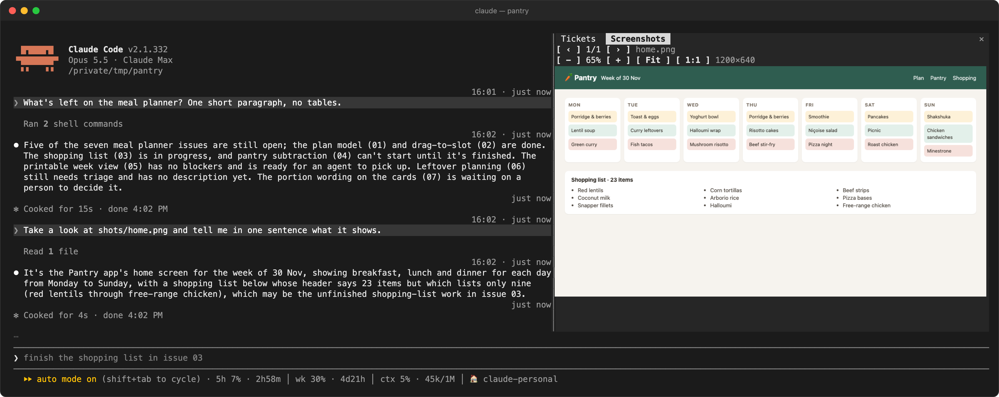
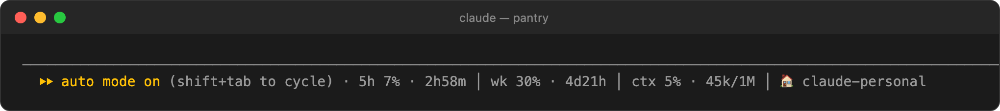
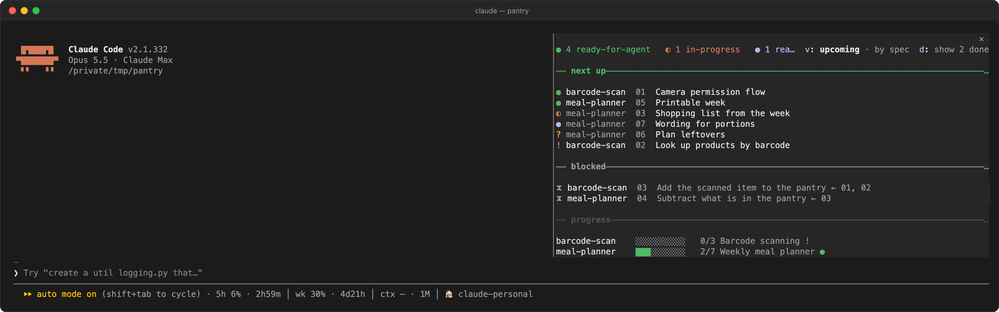
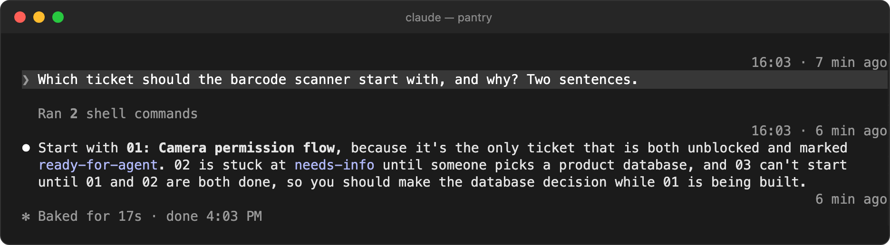
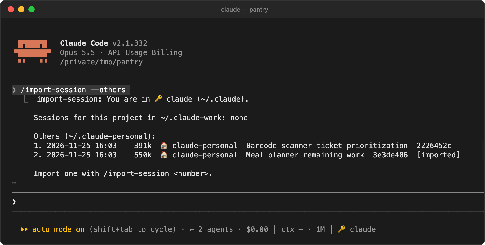

# claude-mods

Mods for [Claude Code](https://claude.com/claude-code): a screenshot pane, plan quota on the status line, a live ticket board, times on every turn, switching sessions between profiles, and two writing skills. They install from one marketplace, `rgs-mods`, and each one works alone.



## Install

At a Claude Code prompt, install any of them:

```
/plugin install screenshots --marketplace rgs-io/claude-mods
/plugin install quota-status --marketplace rgs-io/claude-mods
/plugin install scratch-board --marketplace rgs-io/claude-mods
/plugin install turn-times --marketplace rgs-io/claude-mods
/plugin install import-session --marketplace rgs-io/claude-mods
/plugin install linked-references --marketplace rgs-io/claude-mods
/plugin install writing-for-slack --marketplace rgs-io/claude-mods
```

From a shell it's the same with `claude plugin install …`. Update later with `claude plugin update <mod>@rgs-mods`, then `/reload-plugins`.

The UI mods (the first five) are hooks modules, so they need a Claude Code build that runs mods; they're tested on v2.1.332. The two skills work anywhere skills do.

## UI mods

### [screenshots](screenshots/)

A pane that shows the PNGs Claude reads, or pushes with its `show_image` tool, drawn inline as real images. Step through them, zoom in and out, fit or show 1:1. Needs a terminal with kitty graphics: kitty, Ghostty or iTerm2. Open it with `/screenshots`.

### [quota-status](quota-status/)



On a subscription, how much of the 5-hour and weekly limits you've used and when each resets. On API billing (an API key, Bedrock, Vertex, a gateway), dollars spent this session, split between the main conversation and subagents. Both show how full the context window is.

### [scratch-board](scratch-board/)



A live board of the specs and tickets in your project's `.scratch/` folder: what's next, what's blocked and on what, and progress per spec. It opens itself when `.scratch/` has something in it and updates as files change. Open it with `/tickets`.

### [turn-times](turn-times/)



The clock time and how long ago on each prompt and reply, and on the line that ends each turn. They stay current while you're away, and resumed sessions get theirs from the transcript.

### [import-session](import-session/)



For running Claude Code under several profiles (config dirs, such as `~/.claude` and `~/.claude-work`). `/import-session` lists this project's sessions in your other profiles, and `/import-session <number>` copies one over and resumes it. It also puts the profile you're in at the end of the status line, with an emoji if you like.

## Skills

### [linked-references](linked-references/)

Every PR, issue, Jira or Linear ticket, or commit Claude mentions becomes a link, and gets its title when the sentence doesn't already say what it is: "[ABC-123](https://example.atlassian.net/browse/ABC-123) (Retry failed webhook deliveries)" rather than a bare "ABC-123". It finds the tracker and the Jira site on its own, through `gh` and whichever tracker MCPs are connected.

### [writing-for-slack](writing-for-slack/)

Ask for a message to paste into Slack and it comes back as raw markdown in a block you can copy (`**bold**`, `_italic_`, `-` bullets, `:emoji:`), so Slack formats it when you paste it.

## Development

Each mod is its own folder with a `.claude-plugin/plugin.json`. Run the tests with `claude plugin test <mod>`, and check a mod with `claude plugin validate <mod>`. To try a change, start a session with `claude --plugin-dir <mod>`.

## License

[MIT](LICENSE)
