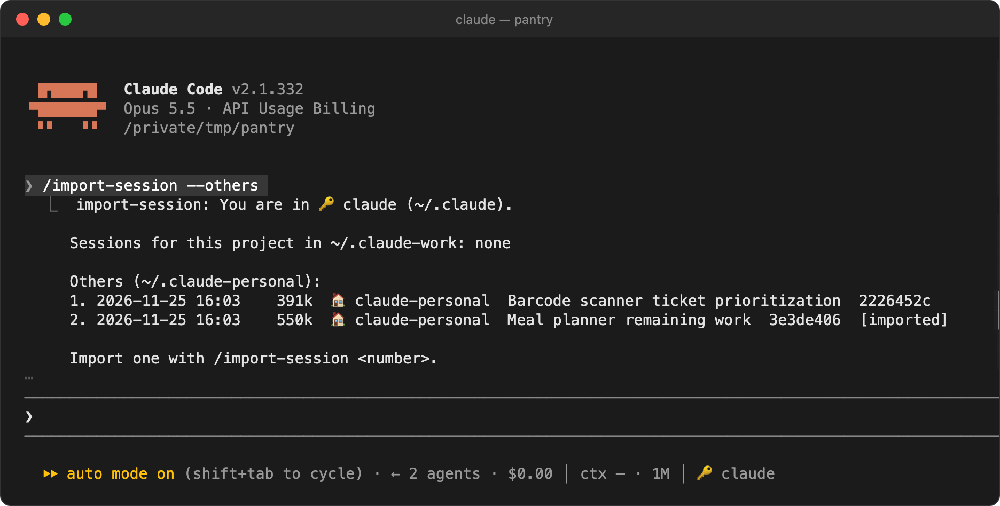

# import-session

For running Claude Code under several profiles, each its own config dir: say `claude` on `~/.claude` and `claude-work` with `CLAUDE_CONFIG_DIR=~/.claude-work`. A session lives in the profile that started it. This mod lists the current project's sessions in your other profiles and copies one over, so you never paste session ids around. It also shows which profile you're in.



## Install

```
/plugin install import-session --marketplace rgs-io/claude-mods
```

## Using it

- `/import-session` lists the current project's sessions in your other profiles, newest first: number, last activity, size, profile, title and short id. Sessions already imported are marked `[imported]`, or `[imported, newer there]` if they've changed since. Extra profiles are folded into one line at the bottom.
- `/import-session --others` also lists the sessions in those folded profiles.
- `/import-session <number>` imports that session and resumes it. You can also give the start of its id or a few words of its title (`/import-session barcode scanner`). Numbers stay the same whether or not `--others` is shown.
- `/import-session <number> --force` copies a session again after it changed in the other profile, overwriting the copy here.
- `/import-session <number> --no-resume` imports without switching to it; open it later with `/resume`.
- Picking a session that's already imported and up to date just resumes it.

An import copies the session's transcript (`projects/<project>/<id>.jsonl`), its folder of subagent transcripts and tool results, and its `file-history`. The original stays where it was.

The profile you're in shows at the end of the line under the prompt: `⏵⏵ auto mode on … │ 💼 claude-work`.

## Settings

Set these in `/config`. Each profile keeps its own settings, so set them in every profile you install the mod in.

- `profiles` (default `claude, claude-work`): the profiles in the main list, comma-separated. An entry is a name (`claude-work` means `~/.claude-work`), a `~/` path or an absolute path. The current profile is always left out.
- `otherProfiles` (default empty): profiles shown only with `--others`, in the same format. Empty means every other `~/.claude*` dir that has a `projects` folder.
- `showProfile` (default on): show the current profile under the prompt.
- `profileEmoji` (default empty): an emoji per profile as `name=emoji` pairs, shown under the prompt and in the list, e.g. `claude=🔑, claude-work=💼, claude-personal=🏠`.
- `autoResume` (default on): switch to a session right after importing it. `--no-resume` skips that for one run; with this off, `--resume` asks for it.

## Notes

- Each session file records the account that created it. The import leaves that as it is, so if `/resume` won't show or open an imported session, check that first.
- Install it in every profile you want to import into: the command imports into the profile it runs in.
