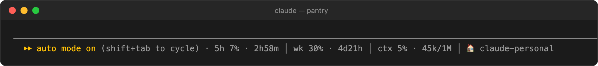

# quota-status

Quota, spend and context at the end of the line under the prompt.



- **On a subscription** (a claude.ai login): how much of the 5-hour and weekly limits you've used, and the time until each resets: `5h 7% · 2h58m │ wk 30% · 4d21h`.
- **On API billing** (an API key, Bedrock, Vertex, a gateway): dollars spent this session, split between the main conversation and subagents: `$4.20 (main $3.10 · agents $1.10)`. Subagents are priced from their transcripts at list price.
- **Always**: how full the context window is: `ctx 5% · 45k/1M`.

Other mods can add their own text after it on the same line; [import-session](../import-session/) puts the current profile there.

No settings.

## Install

```
/plugin install quota-status --marketplace rgs-io/claude-mods
```
