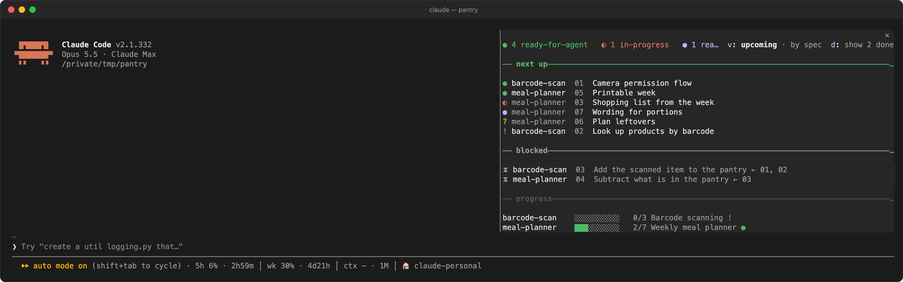

# scratch-board

A live board of the specs and tickets in your project's `.scratch/` folder.



## Install

```
/plugin install scratch-board --marketplace rgs-io/claude-mods
```

## What it reads

One folder per feature, with a spec and numbered tickets:

```
.scratch/
  meal-planner/
    spec.md                  # "# Spec: Weekly meal planner" and "Status: ready-for-agent"
    issues/
      03-shopping-list.md    # "# 03: …", "**Status:** in-progress", "**Blocked by:** 01"
```

Statuses: `ready-for-agent`, `in-progress` (or `claimed`), `ready-for-human`, `needs-triage`, `needs-info`, `done` (or `resolved`) and `wontfix`. A `**What to build:**` paragraph shows when you expand a ticket.

## Using it

- The board opens itself the first time `.scratch/` has something in it, and closes when it empties. `/tickets` opens it any time.
- **next up** lists open, unblocked tickets, ready-for-agent first. **blocked** lists the rest, with the tickets they're waiting on. **progress** shows each spec's done count and status.
- Press a ticket to expand it. `v` switches between one queue and a view grouped by spec. `d` shows or hides finished tickets.
- It refreshes as soon as Claude writes into `.scratch/`, and polls for other changes.

No settings.
