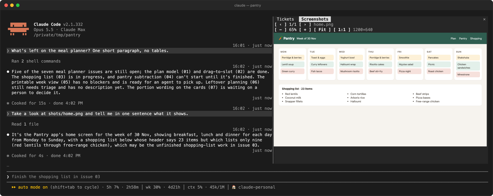

# screenshots

A pane beside the chat that shows PNG screenshots as real images.



## Install

```
/plugin install screenshots --marketplace rgs-io/claude-mods
```

## Using it

- Images land in the pane when Claude reads a `.png` with its Read tool, or pushes one with the `show_image` tool this mod adds (a path, and an optional caption). Agents can use `show_image` to show you what they rendered.
- `/screenshots` opens the pane.
- Keys in the pane: `p` / `l` previous and next image, `i` / `o` zoom in and out, `f` fit to the pane, `n` 1:1.

Needs a terminal that draws kitty graphics: kitty, Ghostty or iTerm2.

## Settings

- `cellPixels` (default `9x19`): the width and height of one terminal cell in pixels, so 1:1 shows an image at its real size. Raise it if 1:1 looks too big.
