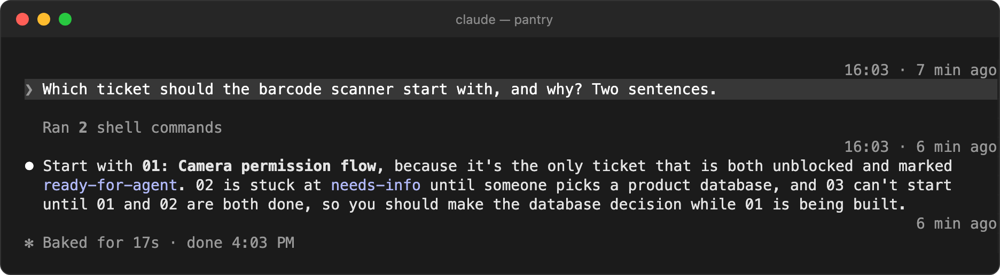

# turn-times

When each prompt and reply happened, and how long ago.



- Each prompt and the first block of each reply gets a faint `14:02 · 12 min ago` at its top right. The line that ends a turn, which already shows its clock time, gets `· 8 min ago`.
- The "ago" part refreshes every minute. On a narrow terminal the clock time is dropped.
- Rows from before the mod loaded, and from sessions you resume, get their times from the session's transcript.

No settings.

## Install

```
/plugin install turn-times --marketplace rgs-io/claude-mods
```
